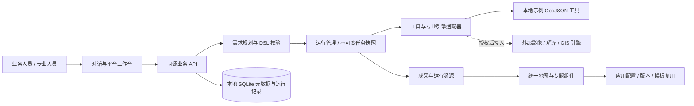

# 经纬 GeoAI 架构与验收基线

> 架构师审查基线。本文定义本轮交付目标与验收边界；以代码、测试和实际运行结果作为已实现能力的证据。

## 1. 平台目标与本轮范围

平台主线：**零散需求 → 结构化业务清单 → 可审查工作流 → 可追溯成果 → 地图专题 → 可复用应用**。

优先解决三类问题：业务语言与专业遥感/GIS操作之间的转换成本；不同来源数据缺少统一空间关联；各地市重复开发地图、专题与业务组件。

| 范围 | 本轮可验收 MVP | 生产平台待建设 |
| --- | --- | --- |
| 需求理解 | 规则驱动的多主题解析、目标归类、数据缺口与待确认项 | 可配置大模型、工具调用、对话澄清、语义评估 |
| 工作流 | 结构化节点、参数快照、独立任务、状态与日志 | 分布式队列、容器执行、资源配额、重试与断点恢复 |
| 空间分析 | 对明确标注的示例 GeoJSON 进行实际过滤、关联或统计 | 授权遥感影像调取、专业模型解译、规模化空间计算 |
| 地图成果 | 按专题和运行成果查询，展示来源、区域、时间与复核状态 | 合规生产底图、真实地块、瓦片/要素服务、大规模三维 |
| 应用构建 | 组件配置驱动实际预览，保存、版本化、复用 | 可扩展组件 SDK、组织级发布流程、API 服务运营 |
| 共享 | 当前本机服务内保存模板与配置 | 身份认证、租户隔离、权限审批、跨组织共享与计量 |
| 数据与系统 | 资源目录、接口配置草案、明确待接入状态 | 授权治理、系统连通性、密钥托管、审计与同步 |

**实际对示例矢量数据计算不等于真实遥感解译。** 示例主体、地块、坐标和汇总均不能作为官方统计、工程验收、食品安全判断或执法认定的依据。

## 2. 主体、资产与平台角色

| 主体/能力 | 资产及权属 | 平台承担的角色 |
| --- | --- | --- |
| 平台建设与运营方 | 平台自身实现的编排、配置、版本、成果组织与服务能力 | 需求组织、工具调度、应用交付、授权与运行记录 |
| 专业遥感/GIS引擎提供方 | 提供方拥有或被授权的影像计算、算法与专业模型 | 通过适配器调用，记录服务来源、版本、输入与输出 |
| 原有农业、水利、供应链系统 | 原系统的数据、流程及其合法授权 | 按授权连接与关联，保留源系统标识与更新机制 |
| 数据主管及提供部门 | 地块、项目、主体、设备、设施与业务数据 | 编目、规范与空间关联；用途与共享服从数据授权 |
| 使用部门与核查人员 | 专题配置、业务确认与现场核查记录 | 任务发起、结果复核、处置与反馈 |

OGE 等外部专业引擎不应被表述为平台自有资产。合作、授权、接口、价格与数据范围需按真实协议确认。本轮不以任一合作方已接入为前提。

## 3. 仙桃农业需求的六类映射

| 业务域 | 归并的原始需求 | 业务对象与预期成果 |
| --- | --- | --- |
| 基础底数 | 农资门店、养殖场、鸡场、猪场、冷链个数/容量、地块与确权 | 主体/设施/地块统一目录、分布与统计 |
| 重要工程 | 高标准农田、尾水治理 | 项目范围、台账、阶段变化、待核查事项 |
| 生产与农产品保护 | 粮食与重要农产品、秋冬播、农机社会化服务 | 生产专题、多期变化、作业轨迹及覆盖 |
| 风险与治理 | 防灾减灾、禁捕巡查、农村边缘污染、黄鳝安全监管 | 风险线索、来源解释、核查任务与处置记录 |
| 特色产业 | 黄鳝、莲藕、养殖—加工—冷链、种子化肥及供应链 | 产业空间链条、服务节点与授权汇总指标 |
| 协同与填报 | 二轮延包、确权、水利平台、已有交易系统、小程序 | 授权接口、统一编码、现场任务及回流 |

“长江禁补”暂按“长江禁捕”理解，需求清单中保留待确认标识。遥感不能直接确认食品安全、土地权属与交易真实性，相关专题必须关联检测、权属、台账或现场证据。

## 4. 需求理解与规划

输入应保留原文，不能只保存解析结果。对原始长需求提取多个主题，每个主题应具有：业务目标、涉及对象、区域、时间、预期成果、依赖数据、所用能力、缺口与人工确认项。

规则解析不能识别的内容应进入“待澄清”，不能默认转为秋冬播。出现多个业务域时，应展示任务组合或专题组合，允许用户选择优先目标，再生成对应工作流。上一次任务的区域、时相与输入不能隐式覆盖当前任务。

例如“所有业务全部上图”应拆为数据编目和空间标准化、遥感变化分析、项目监管、产业链专题及核查填报等并行目标，而不是单条影像处理链。

## 5. 逻辑架构与依赖方向

前端负责表达与交互，不以页面计时器作为任务执行源。业务服务负责参数验证、状态迁移、持久化与接口边界。工具只接收已校验的结构化输入，不能执行需求文本中的任意代码、SQL、Shell 或 URL。

生产环境应把本地工具执行替换为受控工作器，并增加对象存储、空间数据库、消息队列、身份与授权系统；不能直接把开发预览服务暴露为生产平台。

## 6. 工作流 DSL、运行与成果

以下为逻辑契约，具体路由与字段以服务实现和接口文档为准。

- **Workflow**：唯一标识、schema 版本、业务版本、需求原文、区域、时相、requirements、gaps、节点列表、运行模式。
- **Node**：稳定标识、toolId、依赖节点、结构化输入、输入/输出类型、参数约束、引擎来源、是否需要人工复核。
- **Run**：唯一标识、工作流标识/版本、参数与节点快照、创建/开始/结束时间、状态、节点执行记录、错误、成果引用。
- **Artifact**：唯一标识、runId、成果类型、图层或数据引用、来源与处理说明、区域、时相、数据模式、复核状态。
- **AppVersion**：应用标识、版本、名称、组件标识及配置、图层绑定、状态、范围、来源版本、创建时间。

运行快照应在启动时形成并持久化。任务开始后编辑区域、时相、节点或需求，生成的是下一次运行的配置，不得改变正在运行的任务。已发布应用应引用明确版本；复用产生新副本，不能修改原版本。

所有地图成果应能回答：来自哪次任务、用了什么数据、分析什么区域/时间、实际执行了什么处理、是否仅为示例、是否经过人工复核。没有授权数据时，应展示缺口，不生成“已经真实完成解译”的状态。

## 7. 状态机与一致性

建议状态：`queued → running → succeeded | failed | cancelled`。人工复核是成果的独立业务状态，不应与计算完成混淆。

- 状态由服务端管理，前端轮询读取；页面切换不应终止任务或改变结果。
- 每次启动具有新的 runId；重复点击由前端禁用与服务校验共同处理。
- 取消只能取消未结束任务；已成功任务不能被取消操作逆向覆盖。
- 节点错误保存稳定错误码与可理解的原因，不能把异常当成成功。
- 重启后的未完成任务需标记中断/失败，或依据明确恢复策略重试，不能永久显示运行中。
- 有依赖的节点只能在依赖成功后执行；需要人工确认的成果应明确标注待复核。
- SQLite 写入使用事务，并处理并发任务写入；不可把内存线程对象作为唯一记录。

## 8. 组件复用、版本与共享

组件使用稳定 ID，展示名称与业务对象分离。每个组件声明所需图层、输入字段、显示方式及配置。勾选或移除组件必须改变真实预览内容，例如图层、业务卡片、统计、查询或核查列表，不能仅改变标签。

发布前校验名称、至少一个有效组件、配置结构和共享范围。每个发布版本保留配置快照。复用时创建副本，并记录来源版本。本轮本机服务保存只意味着同一服务内可读，不意味着跨组织共享、身份隔离或省域批准发布。

外部共享 API、公开发布、账号登录、服务密钥和组织审批不属于本轮已接入能力；界面不能把尚未实现的范围设置渲染为已经获得授权。

## 9. 部署与数据边界

本轮服务默认绑定 `127.0.0.1`，仅供本机演示和研发。若没有身份认证，服务暴露至局域网或公网会使持久化数据可被其他人读取/修改，不能声称具有生产安全隔离。

服务端限制请求体大小、校验路径与字段、使用参数化 SQL、约束静态文件目录。不得在前端或导出配置中存储真实密钥。接口草案不应自动请求用户输入的地址；生产连通性测试需受控白名单与网络边界。

示例 GeoJSON 应保持有效几何及明确坐标基准。数量统计可直接复核。示例面积可采用已明确方法和精度边界的局部近似，必须先换算长度单位，不得对经纬度坐标直接使用平面面积公式后标为亩/公顷。生产面积成果应采用适合的测地方法或等积投影计算，并完成精度验收。

## 10. 架构验收门槛

| 编号 | 验收操作 | 通过证据 |
| --- | --- | --- |
| A1 | 输入包含底数、工程、秋冬播、禁捕、黄鳝、农机、冷链、填报的长需求 | 展示多个业务主题、数据缺口和待确认项，不只返回单条秋冬播流程 |
| A2 | 启动任务后修改需求或区域 | 原运行的快照与成果保持原值，新配置只影响新任务 |
| A3 | 运行中切换视图、刷新页面 | 同一 runId 可恢复状态并查看日志，无重复执行 |
| A4 | 对已知示例 GeoJSON 执行分析 | 返回可按源数据复核的数量/分类，明确数据为示例 |
| A5 | 查看运行成果并进入地图 | 成果具有 runId、来源、区域、时间、复核状态；地图使用对应成果 |
| A6 | 修改应用组件组合 | 预览的图层或业务模块随配置改变 |
| A7 | 发布、复用、编辑副本 | 发布产生版本；副本编辑不改变原发布配置；空名称/无组件被拒绝 |
| A8 | 传入不合法请求、损坏状态或无结果筛选 | 返回可理解错误/空态，主界面可恢复，无静默成功 |
| A9 | 取消正在运行的任务，重启服务后查询历史 | 状态迁移合理，历史与成果保留，未完成任务有中断处理 |
| A10 | 桌面与窄屏浏览器实际操作 | 无控制台错误、全页横向溢出、被遮挡按钮；关键弹窗可关闭 |
| A11 | 检查所有能力状态与来源说明 | 本地规则、示例计算、外部待接入与已实现功能可区分 |
| A12 | 检查文件服务、SQL 与接口边界 | 路径越界不可读、结构化校验、参数化 SQL，不执行任意用户代码 |

初版 `scripts/check.cjs` 曾采用 DOM stub，只能验证部分函数与渲染字符串；新版已改为语法检查与 Python HTTP 集成测试入口。服务测试与真实浏览器验收应分别记录。最终报告必须区分已测试的服务逻辑、浏览器交互、视觉检查和未完成的生产接入。

## 11. 架构二审结论（2026-11-12）

**结论：服务端设计满足本轮本地工程 MVP 的核心架构门槛，未发现阻断本机试用的问题。** 本结论为源码与测试证据审查，不等于生产准入或前端视觉验收。

二审只读检查了 `server.py`、`tests/test_api.py` 和独立黑盒记录 `docs/QA.md`。未重复执行整套测试，11 项自动测试通过与隔离黑盒复验的运行证据来自对应记录。

| 重点 | 源码核验结论 |
| --- | --- |
| 计划版本与 Run 快照 | 每个分析计划创建新 ID、version=1，无计划原位编辑接口。运行保存 plan_id/plan_version、原需求、区域与时相快照；线程接收独立读取的计划对象，不受页面后续编辑影响。 |
| 执行与终态 | `modify_run` 在锁内读取、判断、更新；cancelled/succeeded/failed 均不再被后续节点写回覆盖。取消与最终成功更新串行裁决。失败/取消重试创建新 runId。服务初始化将遗留运行标为中断失败。 |
| 应用发布与副本 | 应用模块及图层 ID 校验，发布状态与版本更新受锁保护；已发布版本拒绝原位 PATCH 与再次发布。clone 创建独立新 ID，记录 source_app_id/source_version，副本编辑不改原版本。只支持 workspace 范围，拒绝省域发布。 |
| 示例空间计算 | 使用合成 EPSG:4326 GeoJSON，实际按专题及镇域筛选并统计；面积先按局部纬度近似换算为米再计算，成果来源明确记载“局部等距矩形近似面积，仅示例”。未宣称测绘精度或真实遥感解译。 |
| 成果来源 | 运行结果包含本机数据集、mode、run_id、plan_version、区域、时间、引擎列表、面积方法、外部调用 false 与人工复核要求；结果要素亦带 plan_id/run_id/analysis_period。 |
| SQL 与静态文件 | SQL 使用参数绑定；静态根目录仅为 dist，路径 resolve 后检查归属，拒绝越界及隐藏路径，目录索引禁用，GET/HEAD 共享限制。独立 QA 记录有编码路径与 symlink 黑盒复验。 |
| 本地服务边界 | API 检查本地 Host，写操作检查 Origin，限制 JSON 请求体为 256 KB；集成仅存草案，不发请求、不接收凭据字段；配置与限制说明未声称生产认证、多租户或外部服务已经接入。 |

以下属于后续演进项，不阻断当前范围：

1. Run 快照当前保存参数及不可变计划版本引用，节点定义通过不可变计划追溯；若将来开放计划原位编辑、删除、迁移或外部 DSL 导入，应将完整节点与工具版本一起写入执行快照。
2. 当前 DSL 由受控规划器生成，节点按生成顺序执行，并非支持用户任意编排的通用 DAG 执行器。开放编辑后应增加拓扑/输入输出校验、独立产物键和依赖失败传播。
3. 应用版本是“发布一次即冻结，复制为新应用并记录来源”的 MVP 模式，尚非同一应用 ID 下的完整版本历史与回滚。
4. 本机合成统计仅证明工程闭环。大模型语义理解、遥感解译、真实数据授权、数据精度、生产部署及跨机构共享仍未接入或验收。
5. A3 页面刷新/切页、A5 地图成果绑定、A6 组件驱动预览、A10 桌面/窄屏交互与视觉检查，需依据最终前端代码与实际浏览器记录另行判定；本二审不提前宣称通过。

### 前端门槛复核补充

最终只读复核 `dist/app.js`，前次提出的三项一致性问题已落地修复：应用预览与要素详情固定使用明确标注的本机示例源，不再依赖成果页临时选择；历史运行切换同步方案、需求、区域、时相及选择记录；已发布应用保存前创建独立副本，界面说明原发布版本保留，写入请求只传可写配置。

根据**主负责人实际浏览器操作**形成的 `docs/BROWSER_QA.md`，七页已在桌面 1440×1000 与手机 390×844 检查，无页面横向溢出，最终会话控制台为 0 errors / 0 warnings；组件预览从36到15到7个要素、连续保存、发布复制、旧配置执行拦截、任务跨页完成，以及草案/成果选择刷新恢复均有实测记录。本架构师完成源码复核并审阅这些证据，未重复宣称亲自完成浏览器测试。

结合服务端二审与上述前端证据，未发现阻断当前本地工程 MVP 试用的问题。真实大模型、遥感解译、生产部署及跨机构共享边界不变。
