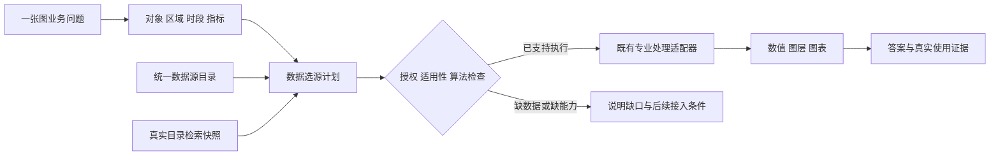

# 多源数据接入与自动选源架构

> 历史记录：本文保留原阶段的设计、实现和验收口径。路径、数量与能力可能已变化；当前说明见[文档导航](../README.md)、[API参考](../reference/API.md)和[架构参考](../reference/ARCHITECTURE.md)。

V8设计基线，2026-11-13。目标是让客户继续在一张图上提问，由后台判断需要哪些观测、业务边界和辅助数据。数据源增加后，应新增适配器与能力声明，而不是为每个供应商再做一套客户操作流程。

本文区分本轮实现的目录、检索、计划及真实运行引用，与尚待授权或开发的执行适配器。接口和实测结果分别见 [API.md](API.md)、[V8_REVIEW.md](V8_REVIEW.md) 和后续V8验收记录。

## 1. 数据、平台与业务的角色

| 对象 | 责任与权属 | 平台承担的工作 |
| --- | --- | --- |
| 卫星/气象等数据提供方 | 提供产品、版本、质量说明、授权与服务条件 | 注册、按授权发现或读取、保留出处，不把上游产品声称为平台自产 |
| 政务与行业部门 | 提供有明确年度和口径的市界、确权、工程及主体台账 | 映射空间对象与业务标识、核验适用范围；未取得数据时保留缺口 |
| 平台与专业算法 | 组织数据、记录处理、提供可复用业务能力 | 自动选源、质量检查、版本绑定与结果交付，逐项声明实际适配能力 |
| 客户 | 提出业务问题，必要时说明对象、区域和时段 | 获得答案、图层、证据及可继续追问的结果，无须配置波段和供应商参数 |

## 2. 统一链路与四类对象

四类对象互相引用、独立留痕：

1. **源注册记录**：描述提供方、产品、协议、时空覆盖、语义、许可、认证、费用说明、适配能力及版本。
2. **检索快照**：保存一次真实查询的条件、时间、各源成功或失败状态、返回条目与截断说明。候选影像不是分析成果。
3. **选源计划**：保存业务需求、候选选择及理由、缺口、拟用流程和执行契约。创建计划不代表已经运行或已满足质量要求。
4. **运行使用证据**：从成功任务的实际provenance读取产品、年度、边界、资产、方法与指纹。不能将计划里的推荐候选复制为“本次实际使用”。

当前面积与小窗分析执行器继续保持已验证边界。增加可检索的数据源，不会自动获得该来源的定标、分类或融合算法。

## 3. 纳入统一架构的数据类型

| 数据族 | 本轮或既有能力 | 后续需要补齐的接入条件 |
| --- | --- | --- |
| 土地覆盖分类产品 | 既有WorldCover2021原生分类面积核算 | 其他年度/区域的产品、真实边界、类别映射与本地精度验证 |
| 多光谱光学 | 既有公开Sentinel-2小范围像素与NDVI；扩展公开目录发现 | 多时相合成、其他传感器定标、云影质量处理、作物分类及大范围执行能力 |
| SAR雷达 | 公开目录发现与候选元数据 | 资产账户授权、极化/轨道兼容、定标、地形处理、斑点噪声与具体业务算法 |
| 长时间序列光学 | Landsat等目录候选 | 按传感器处理波段、比例/偏移、质量位、时相与分辨率差异，不直接套用S2读取规则 |
| 国内高分/商业影像 | 作为后续接入对象登记 | 数据合同、可用地域/年度、分发与衍生物条件、费用和供应商接口 |
| 无人机/现场影像 | 后续影像接入对象 | 采集任务、位置与时间、相机与定标、正射成果、隐私与授权；不能将普通照片当配准影像 |
| 地形/水文/气象 | 既有公开河流参考快照与天气适配器；扩展辅助数据目录 | DEM垂直基准与精度、业务水系与站点、雨量/水位的时间单位及授权 |
| 政务矢量/农业台账 | 既有GeoJSON导入；权威业务数据待对接 | 市界/乡镇界/确权/工程/养殖/冷链等权威来源、业务主键、版本、更新和共享范围 |
| 物联网/北斗轨迹 | 后续事件和轨迹适配器 | 设备身份、事件时间、单位、定位质量、去重补报、离线恢复、业务对象映射与访问控制 |

公网底图只承担地图浏览。显示瓦片不等于已取得可用于面积或光谱分析的原始数据。

## 4. 元数据与接入阶段

目录应同时描述“数据在哪里”和“本平台能做什么”。全球数据覆盖不能等同于本平台已支持全球分析；同一产品的公开目录也不能等同于资产读取授权。

建议持续保留以下元数据组，已有字段以API契约为准：

- 身份：稳定source ID、提供方、产品/集合、版本、源文档与适配器ID。
- 时空：空间覆盖、获取/观测时间、有效时间、入库时间、更新机制、原生分辨率与坐标/高程基准。
- 语义：光学波段或雷达极化、分类码表、物理单位、比例/偏移、无效值与质量掩膜。
- 使用条件：原始许可标识、许可链接、数据与服务费用说明、账户需求、共享与衍生物条件。
- 能力：注册、目录检索、像素/要素/观测读取和具体算法分别声明；非栅格源的像素字段为不适用。
- 验证：最近实测时间、请求条件、成功/失败/未检索、结果数与原因；该记录与长期能力声明分开。

不以一个“已连接”开关概括所有阶段。填写接口草案只表示保存配置，不访问地址、验证授权或开通服务。

## 5. 自动选源的约束

按以下顺序检查，再比较候选质量；不能用高评分绕过硬约束：

1. **业务语义**：需要分类面积、光谱长势、积水识别还是官方台账。NDVI、雷达后向散射和法定耕地不是同一指标。
2. **区域与年度**：行政边界和分类产品分别记录年度。2021产品不能满足2026实况，市级结果不能替代乡镇或地块。
3. **模态与算法**：光学算法要求适用波段与定标；SAR不能当成红光/NIR。新来源即使有数据，也需相应处理适配器。
4. **授权与资源**：确认资产读取权、使用范围及处理额度；无授权的数据可以是待接入候选，不能进入执行绑定。
5. **有效覆盖与质量**：按业务区域实际计算覆盖、云影、无效像素和时相匹配；目录返回景数不等于无云完整覆盖。
6. **成本与替代策略**：先说明数据/服务/存储计算成本与可接受时延；更换数据源需保留原因，不能无声改变指标、年度或分辨率。

多源融合前需统一位置与时间基准、类别或物理量语义和质量标记。分类栅格采用适合类别的重采样；连续物理量按算法声明处理。提升显示分辨率不会产生新的观测信息。

## 6. 适配器边界与后续扩展

未来适配器可分为 `describe`、`discover`、`read`、`quality` 与 `execute` 几层。每个供应商只实现其真实支持的层次，并附测试与验证记录。本轮没有安装任意远程插件，也没有开放任意URL读取器。

| 接入类型 | 采用的边界 | 当前说明 |
| --- | --- | --- |
| 影像发现 | STAC集合/条目、时空搜索与资产元数据 | 本轮固定提供方适配，不声称平台已通过完整STAC服务合规认证 |
| 大栅格 | COG/GeoTIFF及有界窗口读取 | 既有栅格适配器实际使用；其他传感器需单独定标与质量处理 |
| 地图服务 | WMS/WMTS/瓦片服务 | 用于地图显示；不能直接当作原始分析像元 |
| 矢量与业务 | GeoJSON、OGC API Features/WFS、受控REST | GeoJSON已有；其余为后续适配方向 |
| 观测与轨迹 | SensorThings/REST、事件或消息流 | 后续接入，需事件时间、设备与单位语义 |

缓存和成果复用应以来源版本/条目/资产、区域/时段、波段与定标、质量规则、边界指纹、算法版本及访问策略为键。授权失效、源版本变化或产物缺失时不能继续将缓存当有效新答案。后续规模化部署可将当前本机存储拆为元数据目录、对象存储和任务队列；这不属于当前已经部署的集群能力。

## 7. 分阶段落地与验收

业务场景决定数据组合，不能统一套用一份影像：

| 仙桃场景 | 应组织的数据组合 | 应交付及核验的结果 |
| --- | --- | --- |
| 农田底数与变化 | 相应年度光学/分类产品、权威市镇/地块边界、本地验证样本 | 面积、分布与变化；分别验证统计计算与类别精度 |
| 防灾减灾 | 灾前后光学/SAR、地形、降雨水位、受灾地块及现场核查 | 疑似淹水范围、农田叠加与核查清单；风险不能直接当作已确认灾损 |
| 高标准农田/尾水工程 | 工程台账、高分/无人机、验收资料、现场照片与监测 | 工程位置、疑似变化和核查证据；影像不能直接替代工程验收 |
| 黄鳝产业 | 养殖空间、主体与批次台账、水质和检验、加工冷链业务数据 | 空间关联与供应链监管；遥感不能单独证明单尾产地或产品安全 |
| 北斗农机服务 | 设备/机具、作业轨迹、时间与地块、作业记录 | 作业覆盖、轨迹与业务对象关联；定位质量与实际作业状态分别核验 |

建议按下列阶段推进，先用明确业务需求验收，再增加数据数量：

| 阶段 | 交付物 | 验收依据 |
| --- | --- | --- |
| 本轮基础 | 统一目录、固定公开目录检索、计划留痕、现有成果的真实使用绑定、专业数据页 | 真实HTTP、错误/缺口、快照恢复、来源阶段和问答不回归 |
| 授权数据接入 | 国内高分、权威地块/市界、工程与主体台账适配器 | 取得授权、字段/空间/时间质量检查、独立样例与业务口径核验 |
| 多传感器执行 | 雷达、其他光学与多时相合成/融合算法 | 原始资产可读、算法适配、精度与覆盖验证、错误时不替换成果 |
| 持续监测 | 数据更新触发、增量生产、观测/轨迹关联、复查闭环 | 更新时延、有效覆盖、任务追溯、重复与迟到事件处理和业务验收 |

不能以“目录注册数量”作为分析能力验收指标。优先检查需求能否获得适用数据、实际有效覆盖、结果质量、可追溯性和可复用性。

## 官方规范与提供方依据

- [STAC规范说明](https://stacspec.org/en/about/stac-spec/)：条目描述观测时间、资产及关联，支持不同来源的统一发现。
- [OGC COG标准](https://www.ogc.org/standards/ogc-cloud-optimized-geotiff/)：通过栅格内部组织与HTTP Range实现按需读取。
- [OGC API Features](https://www.ogc.org/standards/ogcapi-features/) 与 [SensorThings](https://www.ogc.org/standards/sensorthings/)：分别为矢量要素与传感观测的后续互操作方向。
- [PC Sentinel-1 RTC集合元信息](https://planetarycomputer.microsoft.com/api/stac/v1/collections/sentinel-1-rtc)：公开目录明确说明读取RTC资产需账户；平台不将其标为免授权像素读取。
- [PC Landsat集合元信息](https://planetarycomputer.microsoft.com/api/stac/v1/collections/landsat-c2-l2)：保留上游原始许可标识与USGS许可链接，不从一个字段推断全部使用权。

以上文档于本轮读取；提供方的实时可用性、数据覆盖与授权条件仍以每次实际请求和适用条款为准。
